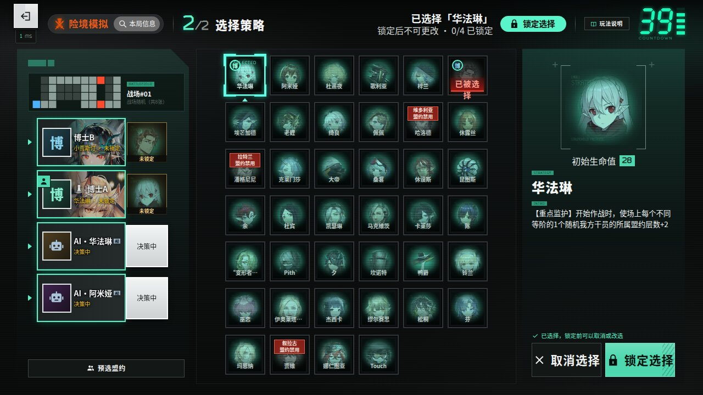
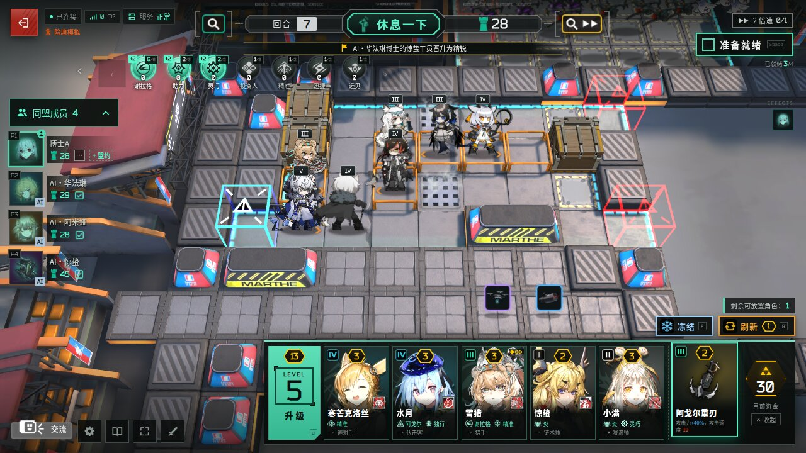
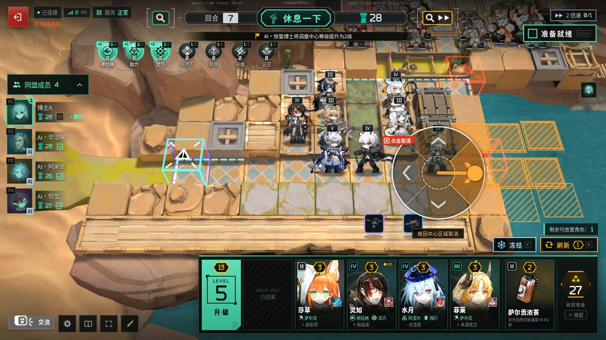
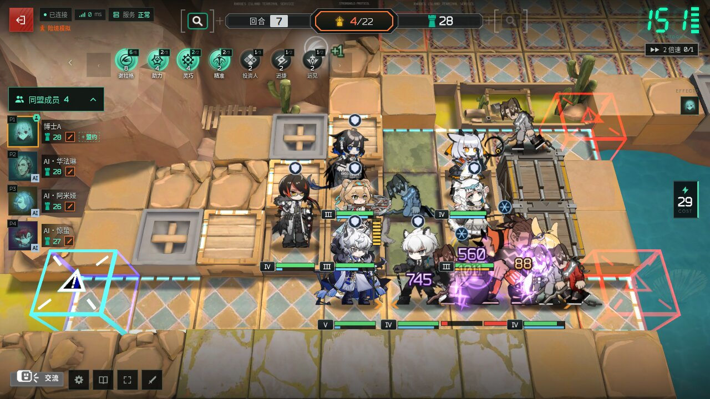

# 卫戍协议：盟约 · Stronghold Protocol: Alliance

> 本仓库是 [sganggs/Stronghold-Protocol](https://github.com/sganggs/Stronghold-Protocol) 的 fork。玩法规则、游戏数据和素材流程跟随上游（目前同步到上游 0.3.3），在此之上增加了公开匹配、扩展人数的好友房、服务器端战斗与集群部署、登录门禁和素材分发等改动，见[与上游的区别](#与上游的区别)。`master` 是开发集成分支，推送不等于线上发布；本文不记录任何部署地址或上线状态。

> [!NOTE]
> 本 fork 的公开服务器自 2026-11-08 17:00（北京时间）起关闭：官方「卫戍协议：规程」开放了，大家去玩官方的吧，我们休赛期见！想继续玩的可以按[快速开始](#快速开始)在自己的电脑上部署。

《明日方舟》季节性自走棋塔防玩法「卫戍协议：盟约」的**非官方同人复刻**：浏览器即开即玩，单人、1–4 人合作，或在好友房里扩展到最多 20 人。


## 声明

> [!IMPORTANT]
> - 本项目是玩家自制的**非官方同人作品**，与上海鹰角网络科技有限公司（Hypergryph）、Yostar 及其关联方**没有任何关系**，未获其授权或认可。
> - 《明日方舟》及「卫戍协议」相关的名称、角色、美术、音乐、音效、文本与数据等素材，版权归原权利人所有。这些素材**不适用**本项目的 GPL-3.0 许可证；GPL 只覆盖本项目自己编写的代码。
> - 仅供学习交流与个人非商业使用。**严禁任何形式的盈利**，包括但不限于：售卖本项目或整合包、付费下载或付费分发、收费服务器或收费代开、广告 / 打赏 / 会员等变现方式，以及其他任何商业用途。
> - 仓库源码不包含游戏的美术与音频素材（只有由官方数据表生成的数据和几张游戏截图，同样不适用 GPL）；上游 [Releases](https://github.com/sganggs/Stronghold-Protocol/releases/latest) 中的完整包为了方便玩家附带了素材（精简包不带，首次启动时从公开镜像下载），下载即视为同意本声明。请勿将素材用于本项目以外的用途或单独再分发。完整条款见 [NOTICE.md](NOTICE.md)。
> - 权利人如认为本项目侵犯其权益，请通过 Issue 联系，我们会**立即删除**相关内容。
> - 本项目按「现状」提供，**不提供任何担保**，使用风险自负。

English summary: [below](#english).

| 同盟房间 | 策略选择 | 休整期（商店 / 盟约） |
|---|---|---|
|  |  |  |
| **部署方向轮盘** | **作战** | **最终攻势** |
|  |  |  |

## 目录

- [声明](#声明) · [简介](#简介) · [与上游的区别](#与上游的区别) · [功能一览](#功能一览)
- [快速开始](#快速开始)：[从源码运行](#从源码运行) · [上游整合包](#上游整合包) · [系统要求](#系统要求) · [端口与配置](#端口与配置) · [局域网联机](#和朋友一起玩局域网)
- [插件](#插件) · [联机方式](#联机方式) · [操作](#操作) · [文档](#文档) · [开发与测试](#开发与测试) · [项目结构](#项目结构)
- [许可证](#许可证) · [致谢与数据来源](#致谢与数据来源) · [贡献](#贡献)

## 简介

「卫戍协议：盟约」是自走棋 + 塔防：休整期在调度中心招募干员、摆阵、配装备，作战期干员自动部署，迎击从红门涌来的敌人，漏过去的敌人扣目标生命值。本项目在浏览器里复刻了这一玩法，规则和数值尽量对照官方数据表与 PRTS 核对。

- **独立模拟**（单人）与**同盟模拟**（合作，没有 PvP）：好友房 1–4 人，空位可以加 AI 队友；也可以在大厅公开匹配真人队友（默认 4 人，也可以选多人同盟）；好友房可选扩展到 8 / 12 / 16 / 20 人。
- **两种运行方式**：
  - **单进程**：和上游一样，一个 Node.js 进程同时提供页面和 WebSocket，战斗默认在各玩家的浏览器里模拟，一台低功耗小主机就能开服。
  - **集群**：一个 coordinator 负责大厅、房间与匹配，多个 game 节点用固定的 Worker 池在服务器上模拟战斗，多个 ingress 转发玩家连接。浏览器在本地演算自己看到的战场，由服务器定期校验，胜负以服务器为准。见 [deploy/stardust/cluster/](deploy/stardust/cluster/README.md)。
- **版本**：玩法与数据同步到上游 0.3.3，默认提供四个官方版本（大厅右上角「版本」）（包括插件系统，见[插件](#插件)；上游的版本记录见 [CHANGELOG.md](CHANGELOG.md)）。本 fork 的改动见下一节和提交记录。仍有少数规则按推断实现，与官方不一致的地方欢迎在 Issue 里反馈。

## 与上游的区别

以下是本 fork 在上游之外新增或改变的部分。上游已有的功能见[功能一览](#功能一览)。

### 联机与房间

- **公开匹配**：在大厅凑齐真人博士开局。单人匹配可以同时选多个难度，也可以选「多人同盟」（8–20 人，最先集齐的人数开局）和「实验性规则」；集齐后 30 秒内在全屏的「确认入场」里各自确认，全部确认后直接开局；不自动补 AI，最多等待 10 分钟。好友小队可以从房间整队匹配，不会被拆散。
- **扩展人数的好友房**（实验性，默认关闭）：人数上限可选 4 / 8 / 12 / 16 / 20（真人与 AI 合计），可以与相同人数模式和难度的其他小队整队匹配；8 人及以上的房间还可以「公开到同盟列表」，其他博士在大厅的「公开同盟」里直接加入。扩展后可多人选择同一策略，机变等选卡统一为六个可重复的选项、所有人同时选择，至少 8 人存活时联防可以有第二轮接力，装备库存按卡池分组。房主还可以勾选「禁用鸭爵策略」。详见 [docs/EXPERIMENTAL-MULTIPLAYER.md](docs/EXPERIMENTAL-MULTIPLAYER.md)。
- **同盟设置与房间规则**：同盟设置和实验性选项在同一个窗口里，分「同盟」「规则」「卡池」三页。规则都默认关闭，开局后不能更改：「队友复活」（队友生命耗尽时，局内任意存活的真人队友可以支付 10 点生命抵消这次死亡，自己至少要有 11 点生命；被救者回到 1 点生命，每人每局最多获救一次）、「禁用共享卡池」（每位博士使用独立卡池）或「手动指定卡池编组」、「禁用层数上限」「禁用单次伤害上限」、敌人生命 / 攻击倍率（生命倍率也可以按回合设置）、「AI 联防置后」（联防先挑真人博士）。
- **联动干员与调控台**（自建房间，开启前都要等 5 秒确认）：「联动干员」（实验性）让全房博士都能在自选里选用 7 名联动干员，开启前须阅读版权风险提示，联动素材单独下载；「调控台」让每位博士在对局中给自己加干员、装备、资金和盟约层数，或给下一场战斗加入敌人，这样的对局不计入战绩、成就与对局记录。开启任一项的房间不能组队匹配。
- **观战**：观战席不限人数；同盟开局后仍可以用原同盟密钥进入观战。
- **AI 队友与挂机**：房主可以指定某个 AI 队友开局时选择的策略；在线但连续 2 回合没有任何操作的玩家会被移出对局，前一回合会先提醒；掉线不算挂机：掉线超过 2 回合由 AI 托管座位，重新连接后收回。
- **策略同时选择**：有两名及以上真人博士时，所有人在同一个 50 秒倒计时里同时选策略：先到先得，「锁定选择」前可以改选或取消，全员锁定后提前结束。单人对局仍是不限时的轮流选择。
- **预选盟约**：可以预选 1 个主盟约和最多 4 个副盟约，全队都能看到，对局中随时可以修改（选完策略后修改会通知所有博士）；本局被禁用的盟约会标出，商店在干员卡的盟约名上标出自己和队友预选的盟约（「设置」里可分别关闭）。只用于沟通，不影响对局。
- **自选编队**：每阶可以设 4 名候选，开局时在简报的「自选上场」里任选 2 名上场；另外加入了塔露拉、冻河、国度，历史版本也能选后来的 6★ 自选干员。
- **战斗 2 倍速**：3/4 在线博士同意后，从下一场战斗起以 2 倍速进行；观战席、AI 队友和已被淘汰的博士不投票。
- **结算**：被淘汰后可以「前往结算」查看战报并继续观战；结算的同盟页可以给同局其他博士点赞。

### 界面

- **干员外观**：干员调配和自选编队里可以选择时装，只改变头像、立绘和战斗小人，不改变属性、技能和伤害。目前收录 195 名干员的 306 套时装（其中 71 套带动态立绘），另有 5 套联动时装只在开启联动干员的房间里使用。见 [docs/OPERATOR-SKINS.md](docs/OPERATOR-SKINS.md)。
- **立绘与名片**：座位卡、干员调配等处的静态立绘改用官方原画；动态立绘在干员调配、自选立绘框、名片和玩家头像里实时播放，部分官方头像也是动态的。座位卡可以「调整立绘」拖动、缩放，名片底图也可以调整，同盟里的博士看到相同的取景。
- **配音语言**：干员配音可选中文、日语、英语，和界面语言分开设置。见 [docs/VOICE-LANGUAGES.md](docs/VOICE-LANGUAGES.md)。
- **完整干员预设**：技能、模组、潜能 / 练度、干员持有、自选编队和外观一起导出、导入，可以带到其他设备。见 [docs/OPERATOR-PRESETS.md](docs/OPERATOR-PRESETS.md)。
- **干员输出统计**：按当前视角显示本轮伤害排行，包括各自行动、联防和 Boss 战。
- **界面大小**：设置里可以把对局界面整体缩放到 70%–120%（手机默认 80%），棋盘随之变大。
- **手机与多人界面**：重新设计了大厅、手机房间页和队伍名单；人数较多或在手机上时，表情改为弹幕显示。
- **大厅信息**：公告、在线人数、WebSocket 往返延迟和服务器负载；维护提示和公告横幅在对局中也会显示，可以关掉。

### 战斗与网络

- **服务器端战斗**：`SP_COMBAT=server` 加上 `SP_COMBAT_WORKERS` 后，战斗在服务器的固定 Worker 池里模拟，另有独立的 AI 试算池；集群的 game 节点总是由服务器模拟。见 [deploy/stardust/WORKERS.md](deploy/stardust/WORKERS.md)。
- **本地演算副本**：服务器模拟时，玩家自己的战场、最终攻势 / 隐秘核心的 Boss 战，以及观看的队友战场都由浏览器本地演算，服务器定期发摘要校验；对不上时自动改回服务器推送的画面。
- **推流优化**：服务器快照频率可选 20 / 10 / 5 Hz；可选的 WebSocket 压缩，每个连接复用同一个压缩上下文，ingress 只压缩大消息（上游 0.2.6 起单进程默认压缩 1 KB 以上的消息，本 fork 仍默认关闭，开启后按消息类型压缩）；Worker 回包精简，多个 Worker 共用一个节拍。
- **状态增量传输**：对局的公共状态和个人状态只发送与上一帧的差异（集群里由 game 节点编码、ingress 原样转发），浏览器还原出完整状态；旧页面和测试客户端仍收完整状态。出现对不上的情况时浏览器自动重连，从完整状态重新开始。
- **弱网素材加载**：素材 8 秒没有任何响应才换源；开始下载后只要还在传输就继续等（20 秒无进展才算超时）；两个源都暂时失败时稍后自动重试。
- **操作即时响应**：购买、出售、部署、刷新、冻结和升级先在浏览器里显示结果，服务器的状态到达后以服务器为准。
- **故障处理**：game 节点重启或断开时，受影响的对局会明确结束并提示，不会卡住（开启断点续玩时从存档恢复）；开局时有玩家连接没就绪，可以直接重试。
- **断点续玩**（可选）：设置 `SP_REDIS_URL` 指向 Valkey / Redis 后，对局在安全点存档，单进程服务器或集群的 game 节点重启后从存档继续，见 [docs/DEPLOY.md](docs/DEPLOY.md) §13。

### 部署与运维（[deploy/stardust/](deploy/stardust/README.md)）

- **集群**：一个 coordinator、16 或 32 个 game 节点、多个 ingress，全部入口共用一个匹配池。ingress 到 coordinator 可选多路复用链路。另有不依赖 WireGuard 的同机部署方式。
- **门禁**：共享口令登录、PRTS 风格的登录动画，以及 ALTCHA 工作量证明。Origin / CSRF 检查严格；私有代码每次请求都过门禁，用 ETag 重新验证，不重复下载。
- **Nginx 模板**：每个 IP 的 WebSocket 并发上限；可选只放行中国大陆 IP，IP 表每日更新，可热加载（[deploy/stardust/geo/](deploy/stardust/geo/README.md)）。
- **素材分发**：不可变素材经 ModelScope、OpenI 等多个源签名重定向，浏览器加载失败时自动回退到其他源。素材按原路径重定向，所以部署模板关闭了上游 0.2.6 的素材内容哈希地址（`SP_ASSET_INDEX=0`）。见 [MATERIAL-SOURCES.md](deploy/stardust/MATERIAL-SOURCES.md) 和 [OPENI.md](deploy/stardust/OPENI.md)。
- **前端打包**：`npm run build` 用 Vite 把界面层（`/js`、`/css`）打成带内容哈希的少量文件，`SP_CLIENT=build` 时首页用打包版本；`/sim`、`/shared`、`/data` 不打包，仍可由创空间公开副本提供。
- **素材缓存**：`/code-source.json` 带上素材 profile 时，Service Worker 按路径缓存已下载的素材，签名地址轮换后不再重复下载；换 profile 时自动清掉旧缓存。
- **玩家反馈板**：门禁后的公开留言板，玩家提交 Bug 和建议，服主可以回复、设置状态（[deploy/stardust/feedback/](deploy/stardust/feedback/README.md)）。
- **运维工具**：在线人数上限可在运行中调整；主线程优先级工具；离线镜像构建；游戏、门禁和素材分别发布、配套回滚的 SOP（[UPDATE-SOP.md](deploy/stardust/UPDATE-SOP.md)、[CLUSTER-SOP.md](deploy/stardust/CLUSTER-SOP.md)）。

## 功能一览

以下是与上游相同的玩法内容。

- **完整的一局**：确认本局信息 → 策略选择（40 名策略）→ 14 回合 → 结算称号；险境及以上满足条件时进入第 15 回合「隐秘核心」。
- **4 种难度**：标准 / 险境 / 绝境 / 终极，独立与同盟各一套参数，均取自官方数据。
- **休整期**：招募、刷新、冻结、升级调度中心；整备区与临时整备区；从整备区拖到棋盘部署，用**方向轮盘**选择朝向。同盟模拟的卡池共用。
- **晋升精锐**：3 名同名干员自动合成精锐，并获得一次高一阶的免费招募。
- **干员与调配**：112 名可招募干员（+ 精锐）及其技能、天赋和特质；开局前可以为每名干员选择携带的技能（283 个技能全部手工实现）和精锐的模组，调配页也可以换成活动「物资调配处」那样的卡片视图。
- **盟约与层数**：23 个盟约（8 个势力核心盟约 + 附加盟约），层数整局保留，每个盟约最多 999 层。
- **装备与机变**：装备与法术，同名装备合成、特定组合赋予盟约效果；已配发的装备锁定在干员身上。部分回合开始前有机变选卡（装备、资金、干员、层数、悬赏等）。
- **自动作战**：技能按官方「技能策略」自动释放；按接触半径阻挡，阻挡者倒下时由接触的干员接替；元素损伤与元素爆发；召唤物由玩家手动摆放；推开 / 拉拽按力度与重量计算；被击倒的干员留在原地显示再部署倒计时。
- **地形与敌人**：阻隔工事、射击台、源石流吹风机、沼泽、排气格栅、涨潮等地形装置；空中与近地悬浮敌人、悬赏敌人。
- **联防**：有人漏怪、又有人完美作战时，完美作战的队友带着阵容帮忙拦截漏掉的敌人。
- **最终攻势与隐秘核心**：两人共享一个战场，全队共同削减同一条领袖血条；10 个敌方领袖，巨型领袖约 5×3 格的受击范围，以及官方的限伤规则。
- **结算称号**：卫戍之星、不朽盟约、坚若磐石等 6 个称号。
- **断线重连**：同盟模拟断线后座位保留到对局结束，掉线的前 2 回合按原阵容自动作战、到时自动准备，仍未回来则由 AI 托管代为操作；对局中重新打开页面即可回到原座位并收回控制。所有博士都掉线时对局暂停（不计时、不作战、AI 也不代打），有人回来就从暂停处继续，10 分钟内没人回来对局结束。也可以主动「暂离」交给 AI 托管；独立模拟 24 小时内可以回来继续（同一个浏览器）。
- **交互细节**：漏怪时顶栏用红字 + 「−N」标记待扣的目标生命值（结算时才扣除）；点选、拖放和配发装备都按地上的方格；购买、升级和机变选卡都需要点两次确认；只有一名玩家时除作战外不计时。
- **画面与声音**：真实 Spine 小人、官方 BGM 与音效、表情（6 套 × 6 个）、作战特效；可选的官方 3D 棋盘（需要从本机客户端提取贴图）与各战场的官方场景。
- **手机与电脑**：触摸拖拽、长按查看详情，推荐横屏；设置里可以调低画质；界面被挖孔、刘海或曲面边缘挡住时可以用「异形屏适配」调整四边。
- **界面语言**：中文（默认）、English、日本語、한국어、繁體中文，见 [docs/I18N.md](docs/I18N.md)。

## 快速开始

### 从源码运行

本 fork 不发布整合包，请从源码运行：

```bash
git clone https://github.com/Stardust-minus/Stronghold-Protocol.git
cd Stronghold-Protocol
npm ci             # 按 lockfile 安装依赖（postinstall 会把 pixi / preact / three 复制到 public/vendor）
npm run setup      # 检查环境，并从公开镜像下载约 720 MB 美术 / 音频（可中断，再次运行会续传）
npm start          # 启动服务器：http://localhost:3000
```

也可以直接运行启动脚本（Windows `scripts\start-windows.bat`，macOS / Linux `scripts/start.sh`）：首次会自动安装依赖、下载素材，然后启动服务器并打开浏览器。四个官方版本默认都开着，大厅右上角有「版本」。启动脚本和 `npm start` 不用加参数。只开第二期下半时设置 `SP_VERSIONS=act2autochess`（大厅不显示版本按钮），详见 [docs/DEPLOY.md](docs/DEPLOY.md) §11。

- 这样启动的是单进程服务器，战斗在浏览器里模拟。想让服务器模拟战斗，设置 `SP_COMBAT=server` 和 `SP_COMBAT_WORKERS`（见[端口与配置](#端口与配置)）；集群部署见 [deploy/stardust/cluster/](deploy/stardust/cluster/README.md)。
- **本地客户端素材（可选）**：官方 3D 棋盘、官方战斗特效（0.3.0「官方特效」）、部分官方界面图标（交流按钮与表情面板的边框、模组类型图标等）、灼热 / 炽焰源石虫和 39 个召唤物（多数自选召唤物）的官方模型需要从本机的《明日方舟》PC 客户端提取（Windows 原生客户端、macOS 的 CrossOver 或 PlayCover）。`npm run setup` 检测到客户端时会询问是否提取（需要 Python 3.8+，依赖装在项目内的 `.venv-extract`，不影响系统）；之后可以用 `node tools/setup.mjs --local` 重新提取，或用 `--game "<…/StreamingAssets/AB/Windows>"` 指定路径；各战场的官方场景可以用 `node tools/setup.mjs --scenes` 下载并提取。没有客户端时游戏照常运行，这几样换成替代样式：2D 棋盘、样式相近的图标、染色的普通源石虫、召唤物头像。表情和「玩法说明」的教程图随上面的素材一起从公开镜像下载，不需要客户端。
- 素材下载优先使用 GitHub，失败时自动改用 jsDelivr 镜像。
- 本 fork 的时装、官方原画立绘、动态立绘和联动素材不在这些公开镜像里，`npm run setup` 不会下载（准备方法见 [docs/OPERATOR-SKINS.md](docs/OPERATOR-SKINS.md)）。`data/assets.json` 仍列着这些文件，所以 setup / doctor 会报告缺少文件；游戏照常运行，只是这些外观显示不完整。
- `npm run doctor`（即 `node tools/doctor.mjs`）可以随时诊断：Node 版本、素材是否完整、端口占用、局域网地址和防火墙。

### 上游整合包

上游 [Releases](https://github.com/sganggs/Stronghold-Protocol/releases/latest) 提供完整包、精简包和更新包，双击即可开服，用法见上游 README 和 [docs/DEPLOY.md](docs/DEPLOY.md)。这些包是**上游版本**，不含本 fork 的改动。没有客户端的服务器（例如 Linux VPS）可以从**同一版本**的整合包（上游完整包）里复制 `public/assets/local/` 和 `data/local-assets.json`，补上本地客户端素材。

### 系统要求

| 项目 | 要求 |
|---|---|
| 开服的电脑 | Windows / macOS / Linux，Node.js 24（LTS，只支持这一版本）；磁盘约 1.2–1.4 GB（素材、依赖与本地提取的贴图、场景和特效）；单进程模式内存空闲约 270 MB，每局再加几 MB；服务器模拟战斗时，CPU 和内存随 Worker 数与同时进行的对局数增加，多少人需要什么配置见 [docs/CAPACITY.md](docs/CAPACITY.md)（公开服实测） |
| 玩家 | 支持 WebGL 的现代浏览器（Chrome / Edge / Firefox / Safari 最新版），电脑、手机或平板（横屏） |
| 网络 | 首次进入游戏时，每位玩家要从开服的电脑下载几十 MB 素材（之后走浏览器缓存）；对局中流量很小，服务器推流战斗时会多一些。上游 0.3.0 里已有素材的玩家可以在标题画面点「导入素材包」（「下载完整素材」旁边），从素材包 zip、完整包 zip 或自己的 `public/assets` 文件夹导入，这部分美术不再从开服的电脑下载；需要 HTTPS 或 localhost（[docs/DEPLOY.md](docs/DEPLOY.md) 2.5 节）。0.3.0 的素材包 `Stronghold-Protocol-v0.3.0-assets.zip` 由上游维护者另行提供下载，不在 Releases 附件里。本 fork 打开页面直接进入大厅，没有标题画面，不显示这两个按钮 |

显卡较弱时可以在「设置」里调低画质，或在网址后加 `?board=2d`（强制 2D 棋盘）/ `?render=fallback`（不用 WebGL 的简化画面）。

### 端口与配置

默认监听 **TCP 3000**。换端口：启动脚本加 `--port 3001`，或设置环境变量 `PORT`。固定私服的同盟密钥：启动脚本加 `--room-code ARK1`（或 `npm start -- --room-code ARK1`），只对本次启动的服务器实例生效；下次不带参数就恢复随机。

| 环境变量 | 默认 | 说明 |
|---|---|---|
| `PORT` | `3000` | 监听端口 |
| `HOST` | `::` | 监听地址。默认 `::` 是双栈：同一个端口同时接受 IPv6 和 IPv4；`0.0.0.0` = 只 IPv4；`127.0.0.1` = 只允许本机，放在反向代理后面时使用 |
| `SP_COMBAT` | `client` | `client`：各玩家浏览器模拟自己的战斗（服务器负载极低）；`server`：由服务器模拟并推流 |
| `SP_COMBAT_WORKERS` | `0` | `SP_COMBAT=server` 时的战斗 Worker 数（0–32）；`0` 在主线程同步模拟 |
| `SP_TRIAL_WORKERS` | `1` | AI 试算 Worker 数（0–2）；需要有战斗 Worker，并且设置了本变量或 `SP_COMBAT=server` |
| `SP_WORKER_YOUNG_MB` | `24` | 每个战斗、试算、仿真 Worker 的 V8 新生代上限（MiB，3–256）；`0` = 交给 V8 自己定（Node 24 默认最多 192 MiB，空闲时也不归还）。主线程的对应设置是 `NODE_OPTIONS=--max-semi-space-size=8`（Docker 镜像已带） |
| `SP_LOCAL_REPLICA` | 开 | 服务器模拟时让浏览器本地演算自己的战场并接受校验；设为 `0` 时改为全部推流 |
| `SP_SNAPSHOT_HZ` | `20` | 服务器战斗快照频率：`20` / `10` / `5` |
| `SP_WS_COMPRESSION` | `off` | `on` 时对战斗流启用 WebSocket 压缩 |
| `SP_ONLINE_LIMIT_FILE` | 空 | 在线人数上限文件（JSON，如 `{"limit": 3000}`），运行中修改后几秒内生效；不设或文件不存在时不限。`"maintenance": 1` 打开维护开关：暂停创建房间、开始模拟和匹配，进行中的对局不受影响 |
| `SP_OWNER_FILE` | 空 | 服主文件（JSON：`{"names": ["保留昵称"], "keySha256": "<服主密钥的 SHA-256>"}`）：带对的密钥进入的玩家显示服主标记，保留昵称只有服主能用；运行中修改后几秒内生效；不设、文件不存在或格式不对时关闭 |
| `SP_VERIFY` | `off` | 服务器复算客户端上报的战斗结果：`off` / `sample`（约 1/8 抽查）/ `all`（全部复算，更耗 CPU） |
| `SP_SHADOW_VERIFY` | `0` | 影子验算（服务器模拟时；服务器的结果始终是唯一依据，浏览器报的只统计、比对）：`0` 只统计（各类战场的演算 CPU、各浏览器本地副本的一致情况）；`1` 另把真人的普通 / 联防战场交给同一进程里**另一局**的一名浏览器（化名后的输入）再算一遍，比对结果哈希。见 docs/design/network.md「Shadow verification」 |
| `SP_SHADOW_VERIFY_RATE` | `1` | `SP_SHADOW_VERIFY=1` 时交出去验算的战场比例（0–1） |
| `SP_SHADOW_VERIFY_MAX` | `64` | 每个进程同时进行的验算上限（1–1000） |
| `SP_SHADOW_VERIFY_PER_ROUND` | `2` | 一个浏览器每回合（按它自己的对局）最多验算几场（1–4） |
| `SP_SHADOW_VERIFY_DEADLINE_MS` | `20000` | 验算者的期限（毫秒，2000–120000）；超时的浏览器 10 分钟内不再被选 |
| `SP_OFFLINE_HOLD_MINUTES` | `10` | 同盟模拟所有博士都掉线时对局暂停多少分钟，没人回来就结束（`1`–`1440`；`0` = 不暂停，按原阵容继续）；独立模拟固定为 24 小时 |
| `SP_BOT_REHEARSAL` | 不设（服务器试算） | 仅 `host` 让房主浏览器帮 AI 队友试算布阵（同源 Worker，只回候选序号）；不设或 `server` 仍由服务器试算。房主无法完成时服务器用同一批候选接手。玩法插件房间始终由服务器试算。真人「AI 托管」和正式战斗不受影响 |
| `TRUST_PROXY` | `auto` | 是否信任 `X-Forwarded-For` 等转发头：`auto` 只信任来自本机 / 内网的代理；`1` 总是；`0` 从不 |
| `DEBUG` | 空 | 设为任意值输出详细日志 |
| `SP_NO_BROWSER` | 空 | 设为 `1` 时启动脚本不自动打开浏览器 |
| `SP_BOT_EMOTES` | 空 | AI 队友的对局表情回应（战斗、整备、合成、联防、收礼时即刻的 `m.emote` 广播）；设为 `0` 时整体关闭 |
| `SP_CLIENT` | `source` | `build` 时首页使用 `npm run build` 生成的打包版本（`public/build/`），没有打包结果时退回源码页面；Docker 镜像默认 `build` |
| `SP_ASSET_INDEX` | 空 | 素材地址带内容哈希、浏览器长期缓存（0.2.6 起默认开启，哈希存在 `.cache/asset-hashes.json`）；设为 `0` 时关闭，素材清单原样下发；本 fork 的部署模板设为 `0`（素材按原路径重定向到外部源） |
| `SP_VERSIONS` | 不设（四个官方版本都开，默认第二期下半） | 收窄启用的版本：不设置与 `all` 相同；`act2autochess` 只开第二期下半，大厅不显示「版本」；也可写逗号分隔的版本 id（如 `act1autochess,act2autochess@V2_1`）。`SP_VERSION_DEFAULT` 指定默认版本，`SP_MAX_VERSION_HOSTS` 限制版本模拟进程数（空闲时不额外启动进程）。详见 [DEPLOY.md](docs/DEPLOY.md) §11 |
| `SP_REDIS_URL` | 空 | 断点续玩：指向 Valkey / Redis 后，重启服务器时对局从存档继续；不设时房间和对局只在内存里。详见 [DEPLOY.md](docs/DEPLOY.md) §13 |
| `SP_BOT_STRATEGY` / `SP_EXTERNAL_AI_*` / `SP_LLM_*` | 不设（内置 AI） | 外部 AI 与顾问模式只在从源码运行时可用；上游的发布包和本仓库的 Docker 镜像会忽略这些变量，仍用内置 AI，并打一行日志。详见 [DEPLOY.md](docs/DEPLOY.md) |

`--room-code` 只接受 4 位字母或数字，不是环境变量，也不会跨重启保留；同一时间只能有一个使用该密钥的房间。固定密钥更容易被猜到，建议只在私服 / 局域网使用。

设置方式：macOS / Linux `PORT=8080 npm start`；PowerShell `$env:PORT=8080; npm start`；cmd `set "PORT=8080" && npm start`。健康检查：`GET /healthz`。集群各角色的配置文件格式见 [deploy/stardust/cluster/](deploy/stardust/cluster/README.md)。

### 和朋友一起玩（局域网）

1. 打开页面 → 输入昵称 → **同盟模拟** →「创建同盟」，直接建好房间（和活动的「联合模拟」一样，难度沿用上次选的）。房主在房间里点底部的难度改难度，可以添加 / 移除 AI 队友；开始前也可以把其他博士移出房间（对方可凭密钥重新加入）。
2. 把 4 位字母的**同盟密钥**，或「复制链接」得到的 `http://<地址>:3000/?room=密钥` 发给朋友。
3. 所有人点「准备就绪」后房主开始。
4. 同一 Wi-Fi / 路由器下的朋友打开启动窗口里列出的地址（形如 `http://192.168.x.x:3000`）即可。打不开时多半是防火墙：Windows 首次启动时在弹窗中允许「专用网络」，或运行 `npm run doctor` 查看具体命令；访客 Wi-Fi 常开启「AP 隔离」，也会导致连不上。

刷新页面或断线后，同盟模拟在对局结束前（所有博士都掉线时为 10 分钟内）、独立模拟 24 小时内重新打开即可回到原座位。服务器把房间和对局都保存在内存里，**重启服务器（集群中的 coordinator 或 game 节点）会结束相关对局**；设置了 `SP_REDIS_URL`（断点续玩，[DEPLOY.md](docs/DEPLOY.md) §13）时，重启后从存档继续。

## 插件

0.3.0 起支持插件；不开插件时按原版游玩。

- **服主安装**：将插件文件夹放进服务器的 `plugins/`，或用 `node tools/plugin.mjs install <zip路径或HTTPS地址>` 安装；远程地址需带 `--sha256`。工作台也支持从社区目录安装和导入 Forge 工坊包。服主可在 `plugins/config.json` 限定可用插件。
- **房主开启**：在房间顶部的「原版 / 插件 ×N」面板里选外观或玩法插件、修改插件设置、选择插件模式。玩法插件的内容会由所有玩家下载并校验，房间标为「非官方」，统计总览默认不计入。
- **玩家个人设置**：「设置 → 外观插件 / 界面插件」只影响自己的浏览器；个人不能另装玩法插件改变房间规则。外观插件只换画面与声音，界面插件只读允许的对局信息。
- **自己制作**：打开启动窗口 `Studio:` 行的地址，使用 `/studio/` 插件工作台选模板、按官方名称选目标、拖放素材、实时预览、试一场并回放，最后打包分享。工作台限本机和局域网，修改需要钥匙。

脚本执行默认关闭。服主可以用 `SP_PLUGIN_SCRIPTS=sandbox` 开启沙箱脚本（或启动时加 `--scripts sandbox`；Windows 双击 `scripts\start-windows-sandbox.bat`）；原生受信任模式还需审查、固定锁文件哈希和玩家同意，公网部署需 `trusted-force`。开服设置见 [部署指南](docs/DEPLOY.md)，作者从[插件新手指南](docs/PLUGIN-GUIDE.md)开始，格式与限制见[插件参考](docs/PLUGINS.md)，接口列表见[插件 API 表](docs/PLUGIN-API.md)。

## 联机方式

朋友不在同一个局域网时，下面是几类常见做法，按自己的情况选一种即可。这里只做简单介绍，提到的工具和服务只是举例，本项目与它们没有任何关系，也不做推荐；具体的安装、费用和使用规则请以各自的官方说明为准。部署细节（防火墙、开机自启、反向代理与 HTTPS、Docker）见 **[docs/DEPLOY.md](docs/DEPLOY.md)**；本 fork 的门禁、Nginx 和集群模板见 **[deploy/stardust/](deploy/stardust/README.md)**。

| 方式 | 怎么做 | 适合 |
|---|---|---|
| **同一局域网直连** | 把启动窗口里的局域网地址发给朋友 | 同一个家、宿舍或网吧 |
| **组网工具（虚拟局域网）** | 例如 Tailscale、ZeroTier、EasyTier、蒲公英：开服的人和朋友都安装同一个工具并加入同一个网络，朋友用开服电脑的虚拟 IP 访问 `http://<虚拟 IP>:3000` | 固定的几个熟人；不暴露到公网。朋友也要装客户端，部分工具需要注册账号；跨地区时可能走中继而变慢 |
| **内网穿透 / 隧道** | 只有开服的人运行客户端，朋友直接打开网址。例如自建的 frp（需要一台有公网 IP 的服务器）、Cloudflare 的 `cloudflared tunnel --url http://localhost:3000`（临时地址，每次启动都会变；国内访问延迟可能较高）、国内的樱花 frp 一类公共穿透服务（通常需要实名，大陆节点承载网页可能有备案要求） | 不想改路由器、没有公网 IP；免费线路带宽小时，首次加载素材会慢一些 |
| **云服务器 / VPS 直接部署** | 在 VPS 上从源码运行，或用仓库自带的 `Dockerfile`；用 Caddy / Nginx 加上 HTTPS。选离玩家近、线路好的地区（面向大陆玩家时，境外机房要关注回程线路，否则晚高峰延迟可能很高；大陆服务器绑定域名需要 ICP 备案） | 想长期开服、玩家分布在不同地区 |

通用注意事项：

- 单进程模式是**单个常驻 Node.js 进程 + WebSocket**（路径 `/ws`），只能跑一个实例，必须部署在域名根路径；Vercel 之类的 Serverless 平台和 GitHub Pages 之类的静态托管都不适用。反向代理要转发 WebSocket 升级。
- 游戏本身没有账号系统，**知道地址的人都能进来**。请只把地址发给需要的人；要对外开放时，至少在前面加一道门禁（本 fork 的口令门禁见 [deploy/stardust/auth/](deploy/stardust/README.md)），这同时能降低素材版权方面的风险。
- 有公网 IPv4 时也可以在路由器上做端口转发，但这会把家里的电脑直接暴露在公网上，优先考虑上面的方式。

## 操作

| 操作 | 方法 |
|---|---|
| 购买 / 升级调度中心 / 机变选卡 | 点一次选中，再点一次确认（`D` 升级） |
| 部署 / 移动干员 | 从整备区拖到棋盘格 → 出现圆形方向轮盘 → 往上 / 右 / 下 / 左滑动选择朝向后松手（在轮盘外按下也行，从按下的位置开始滑）；松在中心或点「✕ 点击取消」取消。拖动时模型平滑地跟着指针 / 手指走，不吸附到格子上；指针 / 手指所在的格子就是落点 |
| 调整朝向 | 把干员拖回它自己的格子，再选方向 |
| 出售 / 撤退 / 销毁装备 | 点击单位所在的格子 → 底部按钮「出售 +1」「撤退」；也可以把棋盘上的干员拖回整备区撤退。整备区里的装备与法术只能「销毁」，已配发的装备锁定在干员身上（干员出售或合成精锐时退回整备区） |
| 装备 | 把装备拖到干员所在的格子上（每人 2 件；满了会弹出替换窗口，被替换的一件会被销毁）；法术拖到地块上并选方向 |
| 查看详情 | 右键或长按单位 / 卡牌（属性为实时数值，高于基础值为绿色、低于为红色） |
| 快捷键 | `W` 购买鼠标指向的商品（无需点击） · `R` 刷新 · `F` 冻结 · `D` 升级 · `Q` 撤退 / `X` 出售干员（选中优先，否则操作鼠标指向的干员） · `Space` 准备就绪 · `Esc` 取消 / 关闭；除 `Esc` 外都可以在「设置 → 快捷键」里改成别的键（[玩法指南 §11](docs/PLAYING.md#11-快捷键)） |
| 方向轮盘键盘操作 | 方向键预览 · `Enter` 确认 · `Esc` 取消 |
| 暂停（独立模拟） | 作战中（含最终攻势 / 隐秘核心）点顶栏的「暂停」或按 `Space`，再点「继续作战」（或 `Space`）继续；同盟模拟的作战不能暂停 |
| 表情 | 左下角「交流」，左右滑动（或方向键）换主题，冷却 1 秒；手机上和人数较多时以弹幕显示 |
| 观战 | 自己的作战结束后（或休整期）点左侧队友头像 →「前往查看」；不参战的朋友可以在大厅输入同盟密钥点「观战」，开局后也可以进入（观战席不限人数） |
| 界面大小 / 配音 / 语言 | 「设置」里调整，只保存在本浏览器 |
| 统计（本机） | 大厅顶栏自己的名片、房间里的「统计数据」：胜率、策略通过率、称号、战斗累计和对局记录（点一行回看结算页）；只存在本机浏览器里，可以导出 / 导入，没清完第一个回合就退出的对局不计入统计（[玩法指南 §13](docs/PLAYING.md#13-统计本机)） |

完整的规则、数值和小技巧见 **[docs/PLAYING.md](docs/PLAYING.md)**（游戏内左下角也有「玩法说明」）。

## 文档

**本 fork 新增**

| 文档 | 内容 |
|---|---|
| [docs/EXPERIMENTAL-MULTIPLAYER.md](docs/EXPERIMENTAL-MULTIPLAYER.md) | 扩展人数的好友房：人数模式、整队匹配、卡池分组、接力联防与复活规则 |
| [docs/OPERATOR-SKINS.md](docs/OPERATOR-SKINS.md) | 干员外观：收录范围、动态立绘、保存方式 |
| [docs/OPERATOR-PRESETS.md](docs/OPERATOR-PRESETS.md) | 完整干员预设的内容、导入导出与旧格式兼容 |
| [docs/VOICE-LANGUAGES.md](docs/VOICE-LANGUAGES.md) | 界面语言与干员配音语言 |
| [docs/LATENCY.md](docs/LATENCY.md) | 延迟探测与服务器压力显示（英文） |
| [docs/SNAPSHOT-RATE.md](docs/SNAPSHOT-RATE.md) | 服务器快照频率与本地演算副本（英文） |
| [docs/CONCURRENCY-ADMISSION.md](docs/CONCURRENCY-ADMISSION.md) | 连接、房间、匹配等数量上限的默认值（英文） |
| [docs/CAPACITY.md](docs/CAPACITY.md) | 开服容量参考：同时在线人数与 CPU、内存、带宽的对应（公开服实测，含不同 CPU 的单核对比） |
| [deploy/stardust/README.md](deploy/stardust/README.md) | 部署覆盖层：门禁、Nginx、素材分发、集群与发布工具的总览 |
| [deploy/stardust/cluster/README.md](deploy/stardust/cluster/README.md) | 集群角色、固定源码构建与受保护的部署材料 |
| [deploy/stardust/UPDATE-SOP.md](deploy/stardust/UPDATE-SOP.md)、[CLUSTER-SOP.md](deploy/stardust/CLUSTER-SOP.md) | 更新与集群发布流程 |

**与上游共有**（部分内容已按本 fork 补充）

| 文档 | 内容 |
|---|---|
| [CHANGELOG.md](CHANGELOG.md) | 上游各版本的更新记录：每个版本修复了什么、哪些反馈经核实不是问题 |
| [docs/PLAYING.md](docs/PLAYING.md) | 玩法指南：流程、经济、招募与晋升、摆阵、联防、盟约、最终攻势、结算称号 |
| [docs/PLUGINS.md](docs/PLUGINS.md) · [docs/PLUGIN-GUIDE.md](docs/PLUGIN-GUIDE.md) | 插件格式、安装与服主策略；中文工作台入门、DSL 和对战试验 |
| [docs/DEPLOY.md](docs/DEPLOY.md) | 部署指南：Windows 开服与开机自启、防火墙、组网 / 隧道、反向代理与 HTTPS、Docker、systemd、排错 |
| [docs/WINDOWS.md](docs/WINDOWS.md) | Windows 便携包：怎么打一份「零安装」包（`scripts/make-windows-bundle.mjs`）、包里放了什么、授权注意事项 |
| [docs/DESIGN.md](docs/DESIGN.md) | 架构与契约（英文）：索引，按章节号找到文件；现行规则在 `docs/design/`（范围与目录分工、坐标与时间、战斗引擎、对局、网络协议、渲染与 UI），各次试玩和各版本的规则修订与依据在 `docs/history/` |
| [docs/ARCHITECTURE.md](docs/ARCHITECTURE.md) | 代码地图（英文）：服务器、联机协议和前后端共用的战斗模拟，目录、数据流，黄金结果与导入边界，常见改动从哪里入手 |
| [CONTRIBUTING.md](CONTRIBUTING.md) | 参与贡献：准备环境、运行测试、忠实原则、提交与 PR 约定、怎样添加自选干员（中文，末尾附英文摘要） |
| [docs/SIM.md](docs/SIM.md) | 战斗模拟引擎参考（英文）：钩子、技能描述格式、职业默认行为 |
| [docs/META.md](docs/META.md) | 对局与经济引擎（英文）：回合流程、商店、联防、最终攻势的实现细节 |
| [docs/DATA.md](docs/DATA.md) | 由官方数据表生成的游戏数据（英文） |
| [docs/ASSETS.md](docs/ASSETS.md) | 素材来源、目录结构与清单（英文） |
| [docs/I18N.md](docs/I18N.md) | 界面语言（英文）：界面文字、游戏文本与服务器消息怎样翻译，覆盖范围；**添加一种语言只需在 `public/i18n/` 放一个语言文件**（社区翻译步骤见「Adding a language」，内容包格式见 [docs/PACKS.md](docs/PACKS.md)） |
| [docs/BALANCE.md](docs/BALANCE.md) | 难度模型与测量（英文） |
| [docs/research/](docs/research/00-INDEX.md) | 官方规则、数据与界面的调研记录 |

## 开发与测试

```bash
npm run dev                 # node --watch：改动服务器代码后自动重启
npm test                    # tools/test-run.mjs，用 node --test 跑全部测试文件：单元 + 集成测试（约 12800 项；缺少素材 / 浏览器的用例会自动跳过）
node --test 'deploy/stardust/auth/test/*.test.mjs' 'deploy/stardust/nginx/test/*.test.mjs'   # 门禁与 Nginx 模板
SP_E2E=1 node --test test/ui/mock.e2e.test.js        # 浏览器端到端测试，需要本机 Chrome（CHROME_PATH 可指定路径）
SP_E2E=1 SP_E2E_GPU=1 node --test test/ui/oxi.e2e.test.js   # 用本机 GPU 画 WebGL（Linux + Mesa），3D 棋盘的测试快很多；对 test/e2e/client.mjs 的 Client 和 real.e2e 生效
SP_REAL_E2E=1 node --test test/ui/real.e2e.test.js   # 需要 Chrome + 已下载的素材
RENDER_E2E=1 node --test 'test/render/*.browser.test.js'   # 渲染测试，部分需要本地提取的棋盘贴图
GOLDEN_FULL=1 node --test test/golden.test.js           # 黄金结果：固定种子的整套战斗与人机对局摘要（默认只跑快速子集）
node tools/perfbench.mjs --cpu 1,4,6 --profile             # 真实战斗的帧耗时基准（Chrome 降速 CPU 近似中低端手机），需要 Chrome + 已下载的素材
```

- 门禁测试前先运行 `node deploy/stardust/tools/prepare-auth-assets.mjs`，它不联网，从已安装的依赖和本地字体生成被忽略的登录页文件。`deploy/stardust/tools/` 里的 Python 工具另有 `test_*.py` 测试。
- `npm test` 会扫描整个工作区；如果本地生成过 `deploy/stardust/build/` 之类被忽略的构建目录，里面的旧源码副本也会被当成测试运行，请先清掉或只传入受 Git 跟踪的测试文件。
- 游戏数据由 `npm run build-data`（`tools/build-data.mjs`）从官方数据表生成，不要手工修改 `data/*.json`。
- 性能测试：`/dev/battle-perf.html` 在浏览器里跑一场真实战斗（对局用的战斗运行器、模拟和渲染），实时显示帧率与逐帧耗时；在手机上打开后点击「开始测量（10 秒）」，生成的报告可以复制后附在反馈中。用到的战斗来自 `node tools/capture-specs.mjs` 从固定种子的机器人对局里截取的数据（`public/dev/perf/`）。
- 黄金结果 `test/golden/*.json` 以上游的官方基线为准，只在有意改变玩法的提交里随改动一起更新（本 fork 改过哪些见 [test/golden/README.md](test/golden/README.md)）：只重构、不改玩法的提交不能改变它们；不要为了让改动通过而重新生成。
- 客户端要兼容 Firefox ESR 115 和较旧的 Safari：CSS 不用 `:has()`、容器查询、`@layer` 和嵌套。
- GitHub Actions（[.github/workflows/ci.yml](.github/workflows/ci.yml)）在 Ubuntu、Node 24 上分四片运行 `npm ci`、`npm test` 和服务器冒烟测试，另有 CI 守卫、lint / 导入边界 / 类型检查和全量黄金结果（Node 22）的任务。
- 代码怎么分层、改某个规则该从哪个文件入手，见 [docs/ARCHITECTURE.md](docs/ARCHITECTURE.md)。

## 项目结构

| 路径 | 内容 |
|---|---|
| `server/` | 入口 `index.js`；Node HTTP 静态服务 + WebSocket（`/ws`，代码在 `http/`）、大厅与匹配（`lobby.js`、`matchmaking.js`）、对局引擎（`match/`，含战斗 Worker 池）、战斗模拟（`sim/`，浏览器与服务器共用）、在线人数上限（`onlineLimit.js`） |
| `server/cluster/` | 集群角色：coordinator、game 节点、ingress，以及它们之间的鉴权 RPC 与多路复用链路 |
| `shared/` | 前后端共用的常量、网络协议、人数模式与时装目录 |
| `public/` | 浏览器客户端（原生 ES 模块，PixiJS + pixi-spine、three.js 3D 棋盘、Preact + htm UI） |
| `data/` | 由官方数据表生成的游戏数据（历史版本的在 `versions/`）、素材清单 `assets.json` 与大厅公告 `announcements.json` |
| `deploy/stardust/` | 部署覆盖层：口令门禁（`auth/`）、Nginx 模板（`nginx/`）、大陆 IP 过滤（`geo/`）、素材分发（`material-lb/`、`openi-resolver/`）、集群模板（`cluster/`）、玩家反馈板（`feedback/`）、发布与宿主工具（`tools/`） |
| `tools/` | `setup.mjs` / `doctor.mjs`、素材下载 `fetch-assets.mjs`、数据构建、本地提取 `local-extract/` |
| `scripts/` | 启动脚本（Windows / macOS / Linux）、Windows 开机自启 |
| `docs/` | 文档与调研 |
| `test/` | `node:test` 测试 |

## 许可证

- **代码**：本项目自己编写的代码以 **GPL-3.0-or-later** 发布，全文见 [LICENSE](LICENSE)；另附一条 GPL 第 7 条的附加许可，允许与 pixi-spine 中的 Spine Runtimes 组合分发（见 [NOTICE.md](NOTICE.md)）。本 fork 的改动同样以 GPL-3.0-or-later 发布。
- **游戏素材不在许可范围内**：《明日方舟》相关的美术、音乐、音效、文本与数据等版权归原权利人所有，不适用 GPL，使用限制见上方的[声明](#声明)和 [NOTICE.md](NOTICE.md)。
- **第三方组件**各自遵循其许可证：通过 npm 安装的库（`node_modules` 中附带各自的许可证文件）、`tools/local-extract/aklz4.py` 的算法（BSD-3-Clause），以及字体等，清单与许可证全文见 [THIRD-PARTY-NOTICES.md](THIRD-PARTY-NOTICES.md)。

## 致谢与数据来源

- 原项目：[sganggs/Stronghold-Protocol](https://github.com/sganggs/Stronghold-Protocol)。本 fork 的玩法、数据、素材流程和大部分代码都来自上游。
- 界面：大厅、选择模拟协议 / 选择同盟方式、同盟房间、干员调配（物资调配处卡片视图）、S.W.E.E.P.报告、成就统计面板、大厅背景与大厅音乐、异形屏适配等界面（2026-10-14 起）由 **Bilibili@雨千代chiyo** 设计制作，前端界面问题可加 QQ 374360968 反馈。本服并入时保留了自己的匹配、AI 队友、实验性选项、皮肤与干员预设等功能，成就、奖杯、名片和服主标记改为不依赖账号的实现。
- 状态增量传输、Vite 前端打包、素材运行时缓存、弱网素材加载、对局内公告横幅、背压丢弃计数、结算页与 3D 场景的修复，以及对局检查点与重启续玩的思路参考了 [xinhai-ai/Stronghold-Protocol](https://github.com/xinhai-ai/Stronghold-Protocol)（GPL-3.0-or-later），按本服的集群和部署方式改写后并入。
- 扩展人数：人数、卡池分组和相关公式参考了 [LongQianChen/Stronghold-Protocol](https://github.com/LongQianChen/Stronghold-Protocol/tree/feat/IncreasePlayerCapacity) 的 `feat/IncreasePlayerCapacity` 分支，经选择性适配，不是整支合并（见 [docs/EXPERIMENTAL-MULTIPLAYER.md](docs/EXPERIMENTAL-MULTIPLAYER.md)）。
- 游戏数据：[Kengxxiao/ArknightsGameData](https://github.com/Kengxxiao/ArknightsGameData)。
- 素材来源：[yuanyan3060/ArknightsGameResource](https://github.com/yuanyan3060/ArknightsGameResource)、[fexli/ArknightsResource](https://github.com/fexli/ArknightsResource)、[isHarryh/Ark-Models](https://github.com/isHarryh/Ark-Models)、[ArknightsAssets/ArknightsAssets2](https://github.com/ArknightsAssets/ArknightsAssets2)；字体来自 [TimWangZi/The-font-of-Arknights](https://github.com/TimWangZi/The-font-of-Arknights) 与 Google Fonts（Noto Sans SC）。详见 [docs/ASSETS.md](docs/ASSETS.md)。
- 规则核对与时装资料参考：[PRTS 明日方舟中文 Wiki](https://prts.wiki/)。
- LZ4AK 解包：`tools/local-extract/aklz4.py` 的算法来自 [isHarryh/Ark-Unpacker](https://github.com/isHarryh/Ark-Unpacker)（BSD-3-Clause，经 MooncellWiki/UnityPy）；解析 Unity 资源使用 [UnityPy](https://github.com/K0lb3/UnityPy)（MIT）。
- 大陆 IP 过滤的数据：[APNIC](https://www.apnic.net/) 的分配统计与 [Loyalsoldier/geoip](https://github.com/Loyalsoldier/geoip)。
- 库：[PixiJS](https://pixijs.com/)（MIT）、[pixi-spine](https://github.com/pixijs/spine)（MIT；其中包含的 Spine Runtime 另受 [Spine Runtimes License](https://esotericsoftware.com/spine-runtimes-license) 约束）、[three.js](https://threejs.org/)（MIT）、[Preact](https://preactjs.com/) + [htm](https://github.com/developit/htm)（MIT）、[ws](https://github.com/websockets/ws)（MIT）、[ALTCHA](https://altcha.org/)（`altcha`、`altcha-lib`，MIT）。

感谢以上项目的作者与维护者，以及鹰角网络带来的这款游戏。

## 贡献

欢迎提 Issue 反馈 bug、与官方规则不一致的地方或改进建议，也欢迎提交 Pull Request：

- 本 fork 新增的功能和部署相关的问题请在本仓库反馈；与上游相同的玩法规则问题也可以直接反馈到[上游](https://github.com/sganggs/Stronghold-Protocol/issues)。
- 准备环境、运行测试、忠实原则和提交约定见 [CONTRIBUTING.md](CONTRIBUTING.md)；本 fork 额外的约定见 [CLAUDE.md](CLAUDE.md)（例如不预先合入上游未合并的 PR、不为掩盖行为变化而重新生成黄金结果）。
- 提交前请运行 `npm test`，并同步更新相关文档；文档使用简体中文，代码与注释使用英文。
- 提交的代码将以 GPL-3.0-or-later 发布。
- 请不要提交任何游戏素材文件（`public/assets/` 等目录已被 `.gitignore` 排除），也不要提交部署地址、凭据或运维记录。
- 本项目坚持非商业：请不要提交广告、付费、打赏等任何形式的变现功能。

---

## English

A fork of [sganggs/Stronghold-Protocol](https://github.com/sganggs/Stronghold-Protocol), an **unofficial, non-commercial fan remake** of Arknights' seasonal auto-chess tower-defense mode *Stronghold Protocol: Alliance*, played in the browser. Gameplay and data follow upstream (currently 0.3.3, with its four official versions); this fork adds multiplayer, server-side combat and deployment work on top.

- **Public server:** this fork's public server closes on 2026-11-08 17:00 (UTC+8), when the official game's 「卫戍协议：规程」 opens — see you in the off-season. To keep playing, run it yourself (see **Run** below).
- **What this fork adds:** public matchmaking (four players, or 8–20 with 多人同盟; several difficulties at once) with whole-party queueing; opt-in friend rooms of 8 / 12 / 16 / 20 players (repeatable drafts, a second relay defense round, grouped stock, optional rescue and independent pools — [docs/EXPERIMENTAL-MULTIPLAYER.md](docs/EXPERIMENTAL-MULTIPLAYER.md)); unlimited spectators, also after the match has started; AI teammate strategies and AFK removal; strategies picked by everyone at once on one 50 s clock, bond pre-picks (one main, up to four secondary, marked in the shop), four 自选 candidates per tier, a 2× battle-speed vote and settlement likes; room rules in one dialog (rescue by any living teammate, independent or hand-made pools, enemy HP / ATK multipliers, no layer or hit caps, AI-last 联防), an experimental collab-operator switch and a 调控台 test console for private rooms; display-only operator skins, the official art as HD static illustrations and live dynamic illustrations, cn / jp / en operator voices, full operator presets, per-view damage boards and an interface scale setting.
- **Server side:** optional server-run combat on a fixed Worker pool (`SP_COMBAT_WORKERS`) with the player's own, boss and watched fields run as browser-side replicas checked by server digests; snapshot rate, WebSocket compression and an online cap that can change at run time; client-side prediction of prep actions; optional match checkpoints in Valkey / Redis (`SP_REDIS_URL`) that survive a restart; a cluster of one coordinator, game nodes and ingresses ([deploy/stardust/cluster/](deploy/stardust/cluster/README.md)); a password gate with ALTCHA proof of work, Nginx templates with per-IP WebSocket caps and an optional mainland-China allowlist, multi-source material delivery and a feedback board ([deploy/stardust/](deploy/stardust/README.md)).
- **Run:** this fork publishes no bundles. From source: `npm ci && npm run setup && npm start` (setup downloads ~720 MB of art from public mirrors), then open <http://localhost:3000>. This fork's skins, HD / dynamic illustrations and collab art are not on those mirrors, so setup reports them missing; the game runs without them. The bundles on upstream's [Releases](https://github.com/sganggs/Stronghold-Protocol/releases/latest) are upstream versions without this fork's changes.
- **Languages:** Chinese (the default), English, 日本語, 한국어 and 繁體中文 — switch in Settings (the lobby's ⚙, or the match's). Game texts come from the official clients; the Japanese, Korean and Traditional Chinese interface strings are machine translations (corrections welcome: [docs/I18N.md](docs/I18N.md)).
- **Play with friends:** create a co-op room and share the 4-letter key or the `?room=KEY` link, or queue for public matchmaking. On a LAN, use the address printed at start; otherwise use a virtual-LAN tool, a tunnel or a VPS — see [docs/DEPLOY.md](docs/DEPLOY.md).
- **Disclaimer:** not affiliated with or endorsed by Hypergryph or Yostar. All Arknights names, art, audio, text and data are © their respective owners and are **not** covered by this project's GPL licence. For study and personal non-commercial use only — no selling, paid distribution, paid servers or monetisation of any kind. Content will be removed on request of the rights holders. Provided "as is", without warranty.
- **License:** code GPL-3.0-or-later ([LICENSE](LICENSE)); game assets excluded.
- **Contributing:** [CONTRIBUTING.md](CONTRIBUTING.md) (an English summary at its end) and this fork's rules in [CLAUDE.md](CLAUDE.md); the code map is [docs/ARCHITECTURE.md](docs/ARCHITECTURE.md).
